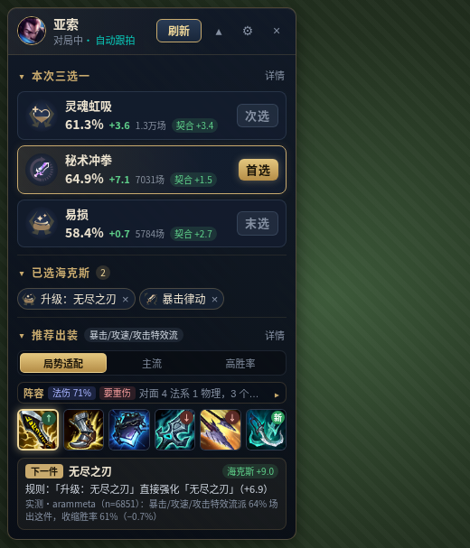
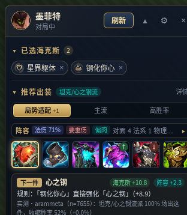
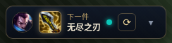

# aramgg_client · 手动刷新浮窗版（Lentolove fork）

<p>
  <a href="https://github.com/Lentolove/aramgg_client/releases/latest"></a>
  
  <a href="https://github.com/Lentolove/aramgg_client/actions/workflows/release-fork.yml"></a>
</p>

英雄联盟 **ARAM 海克斯大乱斗**（queue 2400）的游戏内浮窗助手：三选一出现时你手动点「刷新」（或按快捷键），它只截**一张**图，识别三张海克斯并排序，再根据**已选海克斯 + 双方阵容 + 实时装备**给出可切换的出装方案。

> 本仓库 fork 自 [valkia/aramgg_client](https://github.com/valkia/aramgg_client)（感谢原作者），工作分支为 `manual-overlay`。改动：去掉了持续自动截图，改为常驻浮窗 + 手动刷新；接入 arammeta 实测数据；新增按海克斯/阵容动态出装；自动更新只走本仓库 Releases。
>
> **许可说明**：上游仓库没有附带开源许可证文件（GitHub 显示无 license），本 fork 不新增或更改许可，原代码版权归原作者所有；fork 的改动仅供个人学习使用。arammeta 数据按其 MIT 许可使用并署名（见下文）。

## 界面预览

> 下面是浮窗组件用真实 arammeta 数据渲染出来的样子，背景是占位图，不是游戏内实拍。

<p>
  
  
</p>

收起后只剩一条，显示下一件装备：



## 功能

- **常驻浮窗**：进入对局（游戏内 2999 接口有响应即可，不依赖 LCU 事件）自动出现，置顶、可拖动、记住位置；可选「选人阶段也显示」。浮窗会被排除在截图之外（content protection）。
- **手动刷新**：点「刷新」或按全局快捷键（默认 `Ctrl+Shift+R`，可在浮窗 ⚙ 里改）。每次只做一次整屏截图 → 图标感知哈希匹配 + PaddleOCR 文字识别并行 → 显示三张卡。两者一致标 ✓，只有图标且把握不大时标「待确认」，可手动更正（候选列表或按名字搜索）。
- **三选一排序**：见下文「推荐怎么算」。可在设置里隐藏胜率数字。
- **已选海克斯**：点卡片记为已选，本局内记住，新一局自动清空。
- **动态出装**：随已选海克斯和阵容实时重算；多套方案标签（主流 / 高胜率 / 局势适配）可切换，单个格位也有替代选项；读取 2999 的已有装备并高亮「下一件」。
- **折叠 / 极简**：折叠快捷键默认 `Ctrl+Shift+H`。
- **「可以刷新了」提醒**：每 3 秒读 2999 的等级、游戏时间、是否阵亡（不截图），按等级表（默认 `1,7,11,15`）提示待选次数。
- **刷新日志**：每次刷新/选择/更正写入 `<日志目录>/manual-refresh.jsonl`，用于校准。
- **主窗口**（设置/关于）：保留上游的主窗口，用于偏好设置、版本与更新状态、本地战绩、选人阶段英雄详情等；可从托盘打开。

## 推荐怎么算

**三选一（实测）**：移植 arammeta 的方法。

- 每张卡的胜率向「该英雄基线胜率」做经验贝叶斯收缩（Beta 先验，强度 350）。
- 取后验 10% 保守下界，减去基线作为排序分；同稀有度内给出名次，并显示样本量 n。
- 标签只在这三张之间相对比较（首选 / 次选 / 末选；差距在噪声内标「差不多」）。
- arammeta 没有的卡逐张退回 dtodo 胜率（同样的收缩 + 下界）；都没有时退回热度排序并明确标注。

**出装（实测 + 规则）**：

- 实测部分（arammeta）：路线、核心装、搭配、鞋子出场率、两件装备组合的胜率提升。
- 规则部分：海克斯 → 装备（例如描述里点名的装备、属性倾向）、阵容 → 装备（魔抗/护甲/重伤/破盾/穿透/韧性/保命/补前排/补输出）。数据源**没有**「海克斯 × 装备」「阵容 × 装备」的统计，所以这些是透明的规则加分，有上限，不会盖过英雄本身的统计。
- 每条理由都标明来源：`实测·arammeta` / `实测·dtodo`（带 n）、`规则`、`实时`。

**阵容判断**：双方英雄画像（DDragon 标签 + 人工整理）与 2999 实时装备加权混合，伤害构成参考 arammeta 的英雄局均物理/魔法/真实伤害；「我方缺前排」参考 arammeta 的阵容表。输出中文「阵容判断」和出装需求。

## 数据来源与刷新

| 数据 | 来源 | 刷新 |
| --- | --- | --- |
| 海克斯/英雄统计、出装路线、阵容表 | [arammeta](https://arammeta.com) / [Lanternko/ARAM-Mayhem-Database](https://github.com/Lanternko/ARAM-Mayhem-Database)（MIT） | 英雄数据 6 小时、全局数据 12 小时；过期后用 ETag（`If-None-Match`）复核 |
| 海克斯名称/图标、英雄与装备基础数据、补充胜率 | dtodo 数据 API（`data.dtodo.cn`，图标 `cdn.dtodo.cn` / CommunityDragon） | 启动时与按需读取，带本地缓存和打包的客户端数据 |
| 对局实时信息 | 本机 LCU（只读）和 Live Client Data API `127.0.0.1:2999` | 实时 |

arammeta 镜像顺序：`raw.githubusercontent.com` → `cdn.jsdelivr.net` → `fastly.jsdelivr.net` → `arammeta.com`。缓存在 `<数据目录>/cache/arammeta/`；全部失败时用旧缓存，再不行用安装包内的快照（打包时 `npm run prepare:arammeta` 生成）。

## 安装与更新

1. 从本仓库 [Releases](https://github.com/Lentolove/aramgg_client/releases/latest) 下载 `aramgg_client-Setup-<版本>.exe` 安装（安装包未签名，Windows 可能提示未知发布者）。
2. 自动更新**只检查本仓库的 GitHub Releases**，不会被上游版本覆盖：发现新版本时提示，由你决定是否下载；对局加载或进行中（GameStart / InProgress）不会下载或安装；下载完成后在退出或重启时安装。
3. 从上游或旧版迁移：需要手动安装一次本 fork 的安装包，之后即可自动更新。

**快捷键与托盘**

- `Ctrl+Shift+R`：刷新（识别当前三选一）；`Ctrl+Shift+H`：折叠/展开浮窗。两者都可在浮窗 ⚙ 里修改。全局快捷键会被系统独占，游戏收不到该按键。
- 托盘菜单：打开主窗口 / 隐藏主窗口 / 显示手动浮窗 / 隐藏手动浮窗 / 退出；单击托盘图标切换主窗口。
- 命令行：`aramgg_client.exe --show-manual-overlay` 显示浮窗（程序已在运行时也有效，桌面快捷方式可用）。

## 开发

需要 Node `22.18.0`（npm 10）和 Git，Windows x64。

```powershell
git clone https://github.com/Lentolove/aramgg_client.git
cd aramgg_client
git checkout manual-overlay
npm ci
npm run prepare:client-data
npm run dev          # 开发模式
npm run pack         # 打包 NSIS 安装包（会自动生成 arammeta 快照）
```

提交前：`npm run type-check`、`npm run lint`、`npm test`、`npm run build`（OCR 回归 `npm run test:augment-ocr` 需在 Windows 上运行）。

技术栈：Electron + Vue 3 + electron-vite + TypeScript，PaddleOCR（ONNX）+ sharp。源码在 `src/main/`、`src/preload/`、`src/renderer/`、`src/shared/`，测试在 `tests/`。

**发布**：先 `npm version <x.y.z>`，再把 `manual-overlay` 分支和 `vX.Y.Z` 标签推到本仓库。`.github/workflows/release-fork.yml` 会在 windows-latest 上校验标签与 `package.json` 版本一致、跑单元测试、打包，并把 `.exe`、`.exe.blockmap`、`latest.yml` 发布到对应的 GitHub Release。上游的 `release-windows.yml` 在 fork 中不会运行。

## 已知限制

- 仅支持 Windows。
- Riot 开发者政策规定产品不能显示海克斯（Augment）的胜率；本工具显示胜率处于灰色地带，可在设置里隐藏胜率数字，风险自负。
- arammeta 数据的元数据里没有服务器字段，作者脚本默认 `--platform TW2`、名称为繁体，**推断主要来自台服**，与国服/其他服的环境可能有差异。
- 海克斯 → 装备、阵容 → 装备是规则模型，不是统计结论。
- 建议游戏使用无边框窗口；独占全屏下置顶浮窗可能被盖住。识别准确率、提醒时机、国服客户端 2999 字段仍需更多实机验证。

## 致谢

- [valkia/aramgg_client](https://github.com/valkia/aramgg_client)：原项目。
- [Lanternko/ARAM-Mayhem-Database](https://github.com/Lanternko/ARAM-Mayhem-Database) / [arammeta.com](https://arammeta.com)：ARAM 海克斯大乱斗统计数据（MIT）。
- dtodo（`data.dtodo.cn`）：海克斯与客户端基础数据。
- [CommunityDragon](https://communitydragon.org)：图标资源。

本项目与 Riot Games 无关，未获其认可。
